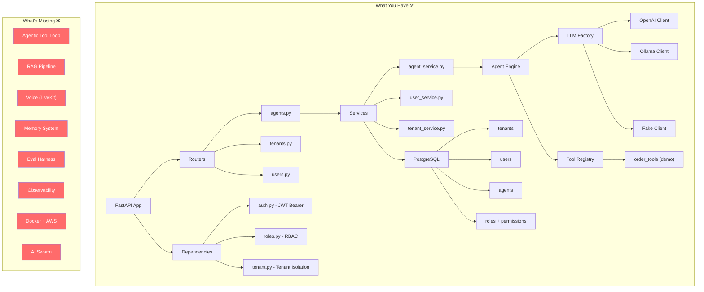

# 🚀 NEXA — Project Status Report

## What Is NEXA?

A **multi-tenant SaaS voice agent platform** — where businesses (tenants) can create, configure, and deploy AI-powered voice agents with tools, memory, RAG, and eventually an "AI Employee Swarm."

---

## 📊 Phase-by-Phase Progress

| Phase | Name | Status | Progress |
|-------|------|--------|----------|
| 1 | Product + Architecture | ✅ Done | ██████████ 100% |
| 2 | Backend (FastAPI + PostgreSQL) | ✅ Done | ██████████ 100% |
| 3 | Multi-tenancy | ✅ Done | ██████████ 100% |
| 4 | Agent Engine | ✅ Done | ██████████ 100% |
| 5 | Tool System | ✅ Done | ██████████ 100% |
| 6 | RAG | ✅ Done | ██████████ 100% |
| 7 | Voice (LiveKit + STT + TTS) | 🟡 In Progress | ████████░░ 80% |
| 8 | Memory | ✅ Done | ██████████ 100% |
| 9 | Evaluation | ❌ Not started | ░░░░░░░░░░ 0% |
| 10 | Observability | ❌ Not started | ░░░░░░░░░░ 0% |
| 11 | Security (RBAC + API keys) | 🟡 Partial | ██████░░░░ 60% |
| 12 | Docker + AWS | ❌ Not started | ░░░░░░░░░░ 0% |
| 13 | AI Employee Swarm | ❌ Not started | ░░░░░░░░░░ 0% |
| 14 | Resume/GitHub | ❌ Not started | ░░░░░░░░░░ 0% |

---

## ✅ What's Already Built

### Phase 2 — Backend
- [main.py](file:///c:/Users/Risis/OneDrive/Desktop/NEXA/main.py) — FastAPI app with 3 routers (agents, tenants, users)
- [database.py](file:///c:/Users/Risis/OneDrive/Desktop/NEXA/database.py) — PostgreSQL via SQLAlchemy with `psycopg2`
- [models.py](file:///c:/Users/Risis/OneDrive/Desktop/NEXA/models.py) — 5 tables: `Tenant`, `User`, `Agent`, `Role`, `Permission` + join table `role_permissions`
- [schemas.py](file:///c:/Users/Risis/OneDrive/Desktop/NEXA/schemas.py) — Pydantic schemas with validation (CreateAgent, UpdateAgent, AgentRunRequest, etc.)
- 12 Alembic migrations tracking incremental schema evolution
- `.env` config for DB credentials, JWT, and OpenAI key

### Phase 3 — Multi-tenancy
- Every `Agent` and `User` has a `tenant_id` foreign key
- All queries filter by `tenant_id` — basic row-level isolation ✅
- [dependencies/tenant.py](file:///c:/Users/Risis/OneDrive/Desktop/NEXA/dependencies/tenant.py) — Extracts tenant from JWT
- Tenant creation is a public endpoint (onboarding flow)

### Phase 4 — Agent Engine
- [engine/agent_engine.py](file:///c:/Users/Risis/OneDrive/Desktop/NEXA/engine/agent_engine.py) — `AgentEngine` class that takes config + LLM client, runs a user message
- [llm/llm_client.py](file:///c:/Users/Risis/OneDrive/Desktop/NEXA/llm/llm_client.py) — Abstract `LLMClient` base class
- [llm/ollama_client.py](file:///c:/Users/Risis/OneDrive/Desktop/NEXA/llm/ollama_client.py) — Ollama integration with `generate`, `generate_with_tools`, `chat_with_tools`
- [llm/openai_client.py](file:///c:/Users/Risis/OneDrive/Desktop/NEXA/llm/openai_client.py) — OpenAI Responses API integration
- [llm/factory.py](file:///c:/Users/Risis/OneDrive/Desktop/NEXA/llm/factory.py) — Factory pattern routing `gpt-*` → OpenAI, `ollama/*` → Ollama, `fake` → mock
- Agent config: `temperature`, `max_tokens`, `top_p`, `system_prompt`, `model_name`
- Agent status lifecycle: `DRAFT → ACTIVE → PAUSED → ARCHIVED` with validated transitions

### Phase 5 — Tool System
- [tools/registry.py](file:///c:/Users/Risis/OneDrive/Desktop/NEXA/tools/registry.py) — Full `ToolRegistry` with register, execute, validate, describe, JSON schema generation
- [tools/decorators.py](file:///c:/Users/Risis/OneDrive/Desktop/NEXA/tools/decorators.py) — `@tool` decorator for clean registration
- [tools/default_registry.py](file:///c:/Users/Risis/OneDrive/Desktop/NEXA/tools/default_registry.py) — Default registry with demo `get_order_status` tool
- JSON schema generation for OpenAI/Ollama function-calling format ✅

### Phase 11 — Security (Partial)
- JWT authentication ([auth.py](file:///c:/Users/Risis/OneDrive/Desktop/NEXA/auth.py)) — create + verify tokens with user_id + tenant_id
- Password hashing with [security.py](file:///c:/Users/Risis/OneDrive/Desktop/NEXA/security.py) (`pwdlib`)
- [dependencies/auth.py](file:///c:/Users/Risis/OneDrive/Desktop/NEXA/dependencies/auth.py) — Bearer token extraction + user lookup
- [dependencies/roles.py](file:///c:/Users/Risis/OneDrive/Desktop/NEXA/dependencies/roles.py) — `require_permission()` — database-backed RBAC checking role → permissions
- [dependencies/permissions.py](file:///c:/Users/Risis/OneDrive/Desktop/NEXA/dependencies/permissions.py) — Permission constants (`agent:read`, `agent:create`, etc.)

---

## 🔴 What's Missing / Incomplete

### Phase 4 — Agent Engine (gaps)
- ❌ **Tool execution loop** — `AgentEngine.run()` calls LLM but never invokes tools. The Ollama client has `generate_with_tools()` and `chat_with_tools()`, but `run()` doesn't use them
- ❌ **Agentic loop** — No multi-turn tool-calling loop (LLM → tool call → tool result → LLM → ...)
- ❌ **Conversation history** — Single-shot only, no message history passed to LLM
- ❌ **Per-tenant tool assignment** — All agents share the same `default_registry`
- ❌ **Streaming** — Everything is synchronous request/response

### Phase 5 — Tool System (gaps)
- ❌ **Dynamic per-agent tool binding** — Can't assign specific tools to specific agents
- ❌ **Tenant-scoped tool registry** — No isolation between tenant tools
- ❌ **Tool persistence** — Tools exist only in code, no DB-backed registry

### Phase 6 — RAG (not started)
- No document upload, no embeddings, no vector store, no retrieval, no citations

### Phase 7 — Voice (not started)
- No LiveKit, no STT, no TTS, no turn detection, no WebSocket/WebRTC

### Phase 8 — Memory (not started)
- No short-term (conversation buffer) or long-term (cross-session) memory

### Phase 9 — Evaluation (not started)
- No automated testing, no eval harness, no quality metrics

### Phase 10 — Observability (not started)
- No structured logging, no distributed tracing, no metrics/dashboards

### Phase 11 — Security (gaps)
- ❌ **API keys** — No API key auth for external integrations
- ❌ **Rate limiting** — No throttling on any endpoint
- ❌ **Role seeding** — No admin bootstrap / default role creation on tenant signup
- ❌ **Input sanitization** — Prompt injection concerns not addressed

### Phase 12 — Docker + AWS (not started)
- No Dockerfile, no docker-compose, no CI/CD, no cloud deployment

### Phase 13 — AI Employee Swarm (not started)
### Phase 14 — Resume/GitHub (not started)

---

## 🏗️ Architecture Diagram

---

## 🎯 What You Should Do Next

> [!IMPORTANT]
> You're solidly through **Phases 2–3** and partially through **4–5**. The critical blocker is that your Agent Engine can talk to LLMs but **can't actually use tools**. This is the heart of an agent platform.

### Immediate Next Step: **Complete Phase 4 — The Agentic Loop**

This is the single most impactful thing to build next:

1. **Implement the tool-calling loop in `AgentEngine.run()`**
   - Send tools schema to LLM → LLM responds with tool calls → execute tools → feed results back → repeat until LLM gives final answer
   - You already have `generate_with_tools()` and `chat_with_tools()` in `OllamaClient` — wire them up

2. **Add conversation history tracking**
   - Pass `messages: list[dict]` through the loop instead of single `user_message`
   - This is prerequisite for both the agentic loop AND Phase 8 (Memory)

3. **Per-agent tool binding**
   - Store which tools an agent can use (in DB or config)
   - Build agent-scoped registry instead of sharing `default_registry`

### After That: The Recommended Order

| Priority | Phase | Why |
|----------|-------|-----|
| 🔥 **NOW** | Phase 4 — Complete agentic loop | Can't demo anything real without it |
| 🔥 **Next** | Phase 5 — Dynamic tool binding | Agents need different tools per tenant |
| 🟠 Then | Phase 8 — Memory | Conversation context is essential for UX |
| 🟠 Then | Phase 6 — RAG | Knowledge retrieval makes agents useful |
| 🟡 Then | Phase 7 — Voice | The "voice agent" differentiator |
| 🟡 Then | Phase 11 — Security hardening | API keys, rate limits, prompt guard |
| ⚪ Then | Phase 10 — Observability | Debug/monitor in production |
| ⚪ Then | Phase 9 — Evaluation | Measure quality at scale |
| ⚪ Then | Phase 12 — Docker + AWS | Deploy it |
| ⚪ Last | Phase 13 — AI Swarm | The grand finale 😈 |
| ⚪ Last | Phase 14 — Resume/GitHub | Polish and ship |

---

> [!TIP]
> Want me to start building the **agentic tool-calling loop** in `AgentEngine.run()`? That's the highest-impact next step — it turns your project from "LLM wrapper" into a real **agent platform**.
